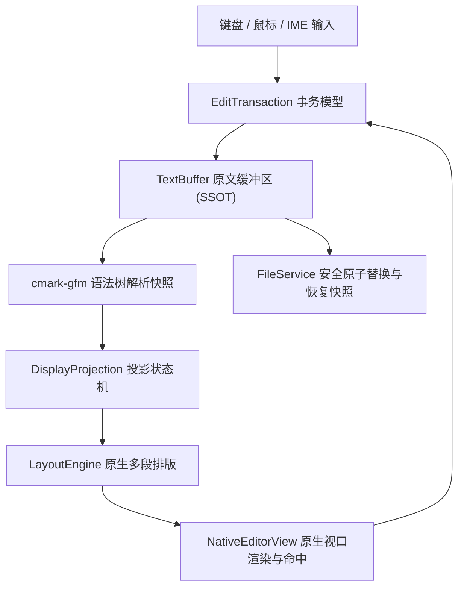

# Native Markdown Editor (Windows)

一款基于 **C++20 + Qt 6 Widgets + cmark-gfm** 的 Windows 原生 Markdown 编辑器。以 **Typora 即时预览** 体验为主线，借鉴 **Bear** 的优雅排版与 **飞书** 的高效操作，严格保证本地 Markdown 原文是**唯一事实来源**。

---

## 核心特性

- **现代桌面视觉设计系统与排版 (Visual Redesign & Design System)**：
  - **优雅双主题引擎**：内置 **Paper Light**（温暖素雅纸质浅色，`#F5F6F8` 外壳 / `#FFFFFF` 编辑区）与 **Graphite Dark**（石墨灰深色，`#181A20` 外壳 / `#242730` 编辑区），支持通过 `Ctrl+T` 快捷键或工具栏按钮一键实时平滑切换；
  - **中英文谐波字体预设与自定义字体**：支持即时替换正文字体，内置**现代无衬线**（首选微软雅黑 `Microsoft YaHei UI` / `PingFang SC`，消除基线跳动，中英混排平整和谐）、**典雅书卷体**（宋体 / `Noto Serif SC` / `Georgia`，纸书文人质感）、**极客等宽体**（`Cascadia Code` / `Consolas`），并支持通过 `Ctrl+Shift+F` 自由选择本机任意系统字体；
  - **多维字号平滑缩放**：支持快捷键 `Ctrl+=` 放大、`Ctrl+-` 缩小、`Ctrl+0` 重置，或使用 `Ctrl + 滚轮` 实时无级平滑缩放，标题与正文字号等比协调缩放；
  - **自然平滑滚轮与触控板滚动**：原生优化滚轮步长，单格滚轮自然翻动 3 行文本（约 78px），消除生硬缓慢感；完美兼容笔记本精准触控板（Precision Touchpad）高精度像素级滑动；
  - **780px 舒适阅读宽度**：编辑器正文严格遵循现代排版规范，固定最大阅读宽度 780px，随窗口缩放自适应水平居中留白，并设置 56px 顶部呼吸留白；
  - **42px 现代精简工具栏**：去除冗长文字标签，全量采用 18px 线性矢量 SVG 纯图标，包含侧边栏折叠、文件操作、撤销重做、查找替换、字体排版、主题切换与模式切换；
  - **现代 Segmented Control 侧边栏**：去除传统 `QTabWidget` 标签页，改用 Pill 胶囊切换器与实时搜索过滤输入框；大纲去除显眼的 "H1/H2" 前缀文字，采用自然缩进与字重呈现；
  - **26px 弱视觉层级状态栏**：紧凑展示行列位置、字数统计、字符编码与保存状态；
  - **全组件视觉统一**：编辑器内部 `QPainter` 绘制的段落、代码背景、公式卡片、引用条与表格等全面消费 `ThemeManager` 调色板，彻底杜绝明暗冲突。
- **100% 原生桌面技术栈**：编辑区、排版、光标、选区和中文输入法均由原生 C++20 + Qt Widgets（`QAbstractScrollArea` + `QTextLayout`）实现，不依赖任何 Electron、WebView 或浏览器 DOM。
- **原文唯一事实来源 (Single Source of Truth)**：绝不通过“富文本导入导出”重新格式化文档，保留 UTF-8 BOM、CRLF/LF 换行及尾部空白，无修改保存 100% 字节一致。
- **即时预览状态机 (In-place Live Preview)**：
  - 光标进入语法范围（加粗、斜体、代码、标题等）自动展开 Markdown 标记供就地编辑；
  - 移出语法范围时平滑过渡，自动隐藏标记并呈现渲染效果；
  - 提供规范落点（Canonical Drop Points），左右导航智能跳过隐藏标记，无光标黑洞。
- **中文输入法深度适配 (IME)**：
  - 完整实现 `QInputMethodEvent` 与 `inputMethodQuery`；
  - 拼音预编辑文本动态参与行排版与换行推移，彻底避免与现有文字重合；
  - 候选框像素级紧跟光标。
- **高效写作与飞书风格交互**：
  - **段首斜杠命令菜单**：段首输入 `/` 呼出快捷插入面板（标题、代码块、引用、列表、表格等）；
  - **任务列表交互**：在即时预览模式下直接点击 `[ ]` 翻转勾选状态；
  - **结构延续**：按 Enter 智能延续无序/有序/任务列表，连续回车或退格退出列表。
- **原生拖拽 (Drag & Drop) 交互支持**：
  - **文档拖拽打开**：将本地 Markdown 文件（`.md`, `.txt` 等）拖放至编辑器或窗口任意区域，即时加载打开；
  - **图片拖拽插入**：将本地图片文件（`.png`, `.jpg`, `.jpeg`, `.gif`, `.svg`, `.webp`, `.bmp`, `.ico`）拖放至编辑视口，在鼠标释放点就地插入标准 Markdown 图片语法 ``，并无缝纳入即时预览与撤销/重做（Undo/Redo）事务栈；
  - **文件夹拖拽导入**：将目录直接拖放至窗口或视口，自动将侧边栏切换并展开至该工作区目录；
  - **通用文件与文本拖拽**：非图片文件自动插入为 `[文件名](路径)` 链接，外部纯文本直接插入落点光标位置。
- **文件可靠性与安全保存**：
  - 同卷临时文件安全落盘后原子替换（Windows 原生 `MoveFileExW`）；
  - SHA-256 哈希基线比较，外部程序篡改冲突拦截；
  - 后台自动崩溃恢复快照备份。
- **组织与工作区**：
  - 动态双侧栏：实时解析文档 AST，生成 H1~H6 大纲目录树，支持点击瞬时定位跳转；工作区文件树导航；
  - 浮动查找与替换面板（`Ctrl+F` / `Ctrl+H`），支持全文批量替换单次撤销。
- **数学公式与 Mermaid 异步渲染规范**：
  - 基于后台线程池与 `AsyncRenderService` 实现零主线程卡顿的异步 SVG 渲染、代际隔离安全机制与 LRU 字节预算缓存；
  - **定位声明**：本编辑器数学与图表渲染器为轻量级原生 C++ 自研矢量引擎，专为即时预览交互与极速写作排版打造，**非完整 TeX/AMS-LaTeX 宏包排版系统**（暂不支持 `\begin{align}`, `\begin{matrix}`, 复杂宏包定义及多行对齐方程组）；
  - **LaTeX 数学有限支持范围**：
    - **语法范围**：目前专注于独立块级数学公式 `$$...$$` 与 ````math / ````latex 代码块的异步卡片预览渲染；行内公式（单 `$`）暂保持原生 Markdown 文本排版，后续版本规划行内矢量化支持；
    - **分式排版**：支持单层与有限深度（递归深度 $\le 6$）嵌套 `\frac{num}{den}`，分式横线与分子分母在几何坐标上严格垂直互斥并保持安全净距；
    - **上下标**：支持上标 `^`、下标 `_`（如 `x^2`, `x_i`, `x_{i+1}`）；
    - **常见大算子与符号**：求和 `\sum`、积分 `\int`、连乘 `\prod`、常用希腊字母（`\alpha`, `\beta`, `\gamma`, `\theta`, `\pi` 等）；
    - **未实现特性与降级**：根号 `\sqrt{...}`、矩阵环境 `matrix`、方程对齐 `align` 暂未实现；语法异常或未覆盖命令采用安全文本直通与降级提示卡片，保障编辑与渲染绝不崩溃；
  - **Mermaid 图表有限支持范围**：
    - **Flowchart 流程图**（`graph TD`, `graph LR`）：支持单向箭头 `-->`、多节点连续链式箭头 `A --> B --> C`、带标签箭头 `-->|text|`、自环（self-loop）与反向循环回路；
    - **坐标归一化平移**（Normalize Coordinates）：viewBox 动态适应所有图形元素与箭头外轮廓，彻底杜绝边框与拐角裁切；
    - **规模保护**：受控图表规模上限（节点数 $\le 150$，边数 $\le 300$，超出时呈现友好资源限制提示；画布视口自动约束在 360px ~ 3000px 范围内）；
    - **Sequence Diagram 时序图**（`sequenceDiagram`）：支持参与者生命线与单向消息调用；
    - **降级机制**：暂未支持的图表类型（如甘特图 `gantt`、饼图 `pie`、类图 `classDiagram` 等）统一呈现包含源码摘要的提示卡片；
  - **运行时依赖**：Windows 打包部署中 `Qt6Svg.dll` 为必需依赖项。

---

## 构建与运行

### 环境要求
- Windows 10 / 11 (x64)
- Visual Studio 2022 (MSVC v143, C++20)
- CMake >= 3.20
- Qt 6 (6.6+ 或 6.8+，包含 Core, Gui, Widgets, Test, Svg)
- Ninja 构建工具（推荐）

### 编译步骤
```powershell
# 1. 初始化 VS2022 开发人员环境
call "C:\Program Files\Microsoft Visual Studio\2022\Professional\VC\Auxiliary\Build\vcvars64.bat"

# 2. 设置 Qt 路径并配置 CMake
set "CMAKE_PREFIX_PATH=C:\Qt\6.8.2\msvc2022_64"
cmake -B build -G "Ninja" -DCMAKE_BUILD_TYPE=Release

# 3. 执行编译
cmake --build build

# 4. 运行全量探针自动化测试
set "PATH=C:\Qt\6.8.2\msvc2022_64\bin;%PATH%"
.\build\test_probes.exe -v2

# 5. 打包便携运行时并运行主程序
windeployqt --compiler-runtime build\MarkdownNativeEditor.exe
.\build\MarkdownNativeEditor.exe
```

---

## 架构概览



---

## 许可证
本项目采用 MIT 许可证。内置依赖 `cmark-gfm` 遵循 BSD-2-Clause 许可证。
