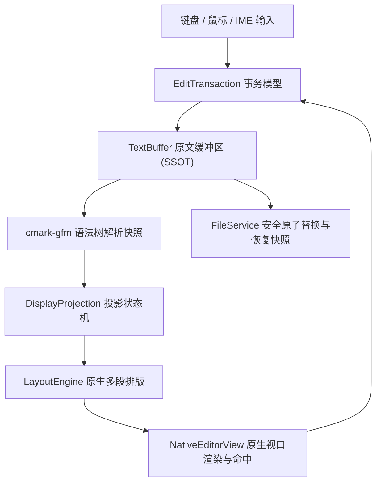

# Native Markdown Editor (Windows)

一款基于 **C++20 + Qt 6 Widgets + cmark-gfm** 的 Windows 原生 Markdown 编辑器。以 **Typora 即时预览** 体验为主线，借鉴 **Bear** 的优雅排版与 **飞书** 的高效操作，严格保证本地 Markdown 原文是**唯一事实来源**。

---

## 核心特性

- **100% 原生桌面技术栈**：编辑区、排版、光标、选区和中文输入法均由原生 C++20 + Qt Widgets（`QAbstractScrollArea` + `QTextLayout`）实现，不依赖任何 Electron、WebView 或浏览器 DOM。
- **原文唯一事实来源 (Single Source of Truth)**：绝不通过“富文本导入导出”重新格式化文档，保留 UTF-8 BOM、CRLF/LF 换行及尾部空白，无修改保存 100% 字节一致。
- **即时预览状态机 (In-place Live Preview)**：
  - 光标进入语法范围（加粗、斜体、代码、标题等）自动展开 Markdown 标记供就地编辑；
  - 移出语法范围时平滑过渡，自动隐藏标记并呈现渲染效果；
  - 提供规范落点（Canonical Drop Points），左右导航智能跳过隐藏标记，无光标黑洞。
- **中文输入法深度适配 (IME)**：
  - 完整实现 `QInputMethodEvent` 与 `inputMethodQuery`；
  - 拼音预编辑文本动态参与行排版与换行推移，彻底避免与现有文字重合；
  - 候选框像素级紧跟光标。
- **高效写作与飞书风格交互**：
  - **段首斜杠命令菜单**：段首输入 `/` 呼出快捷插入面板（标题、代码块、引用、列表、表格等）；
  - **任务列表交互**：在即时预览模式下直接点击 `[ ]` 翻转勾选状态；
  - **结构延续**：按 Enter 智能延续无序/有序/任务列表，连续回车或退格退出列表。
- **文件可靠性与安全保存**：
  - 同卷临时文件安全落盘后原子替换（Windows 原生 `MoveFileExW`）；
  - SHA-256 哈希基线比较，外部程序篡改冲突拦截；
  - 后台自动崩溃恢复快照备份。
- **组织与工作区**：
  - 动态双侧栏：实时解析文档 AST，生成 H1~H6 大纲目录树，支持点击瞬时定位跳转；工作区文件树导航；
  - 浮动查找与替换面板（`Ctrl+F` / `Ctrl+H`），支持全文批量替换单次撤销。
- **数学公式与 Mermaid 异步渲染规范**：
  - 基于后台线程池与 `AsyncRenderService` 实现零主线程卡顿的异步 SVG 渲染与 LRU 字节预算缓存；
  - **LaTeX 数学支持范围**：支持分式 `\frac`（有限深度递归嵌套排版与垂直几何隔离）、上下标 `^`/`_`、大符号求和 `\sum`、积分 `\int`、连乘 `\prod`、常用希腊字母与代数符号。未覆盖的高级宏命令采用字符直通与优雅降级；
  - **Mermaid 图表支持范围**：支持 Flowchart 流程图（TD/LR，含单向/双向/链式箭头、自环及回边自适应平移防裁切）和 Sequence Diagram 时序图；暂不支持类型（如甘特图、饼图等）呈现包含源码摘要的提示卡片。

---

## 构建与运行

### 环境要求
- Windows 10 / 11 (x64)
- Visual Studio 2022 (MSVC v143, C++20)
- CMake >= 3.20
- Qt 6 (6.6+ 或 6.8+，包含 Core, Gui, Widgets, Test)
- Ninja 构建工具（推荐）

### 编译步骤
```powershell
# 1. 初始化 VS2022 开发人员环境
call "C:\Program Files\Microsoft Visual Studio\2022\Professional\VC\Auxiliary\Build\vcvars64.bat"

# 2. 设置 Qt 路径并配置 CMake
set "CMAKE_PREFIX_PATH=C:\Qt\6.8.2\msvc2022_64"
cmake -B build -G "Ninja" -DCMAKE_BUILD_TYPE=Release

# 3. 执行编译
cmake --build build

# 4. 运行全量探针自动化测试
set "PATH=C:\Qt\6.8.2\msvc2022_64\bin;%PATH%"
.\build\test_probes.exe -v2

# 5. 打包便携运行时并运行主程序
windeployqt --compiler-runtime build\MarkdownNativeEditor.exe
.\build\MarkdownNativeEditor.exe
```

---

## 架构概览



---

## 许可证
本项目采用 MIT 许可证。内置依赖 `cmark-gfm` 遵循 BSD-2-Clause 许可证。
